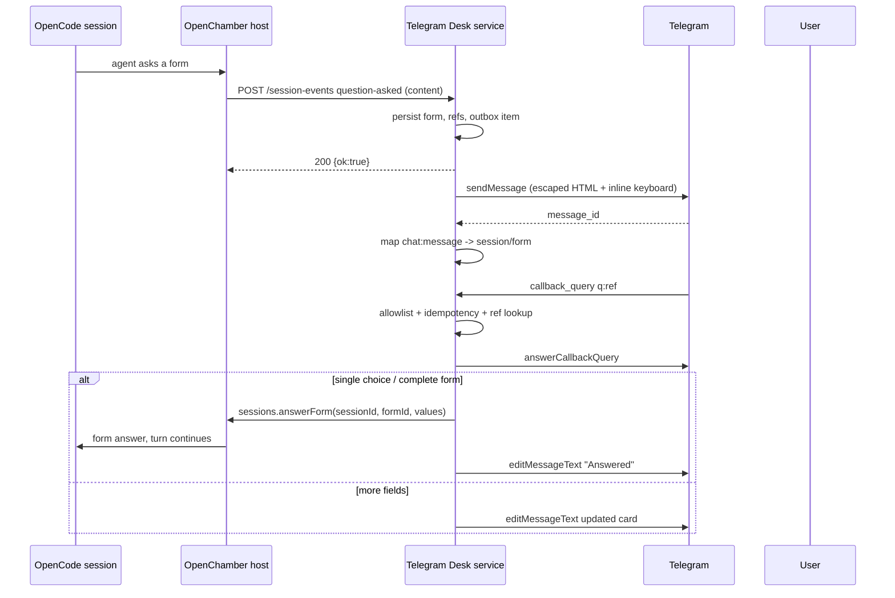
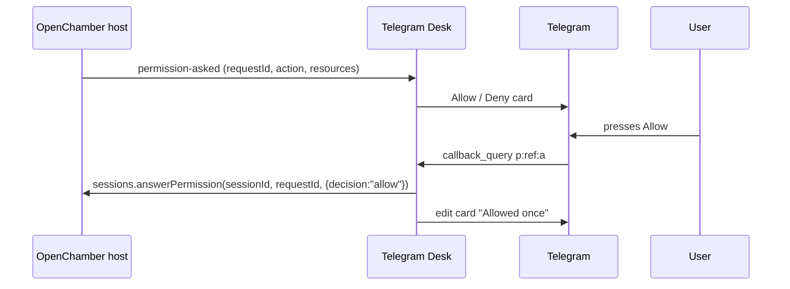
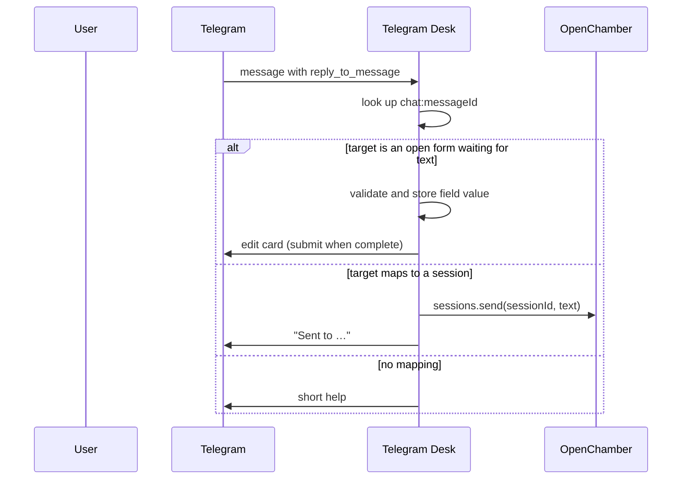
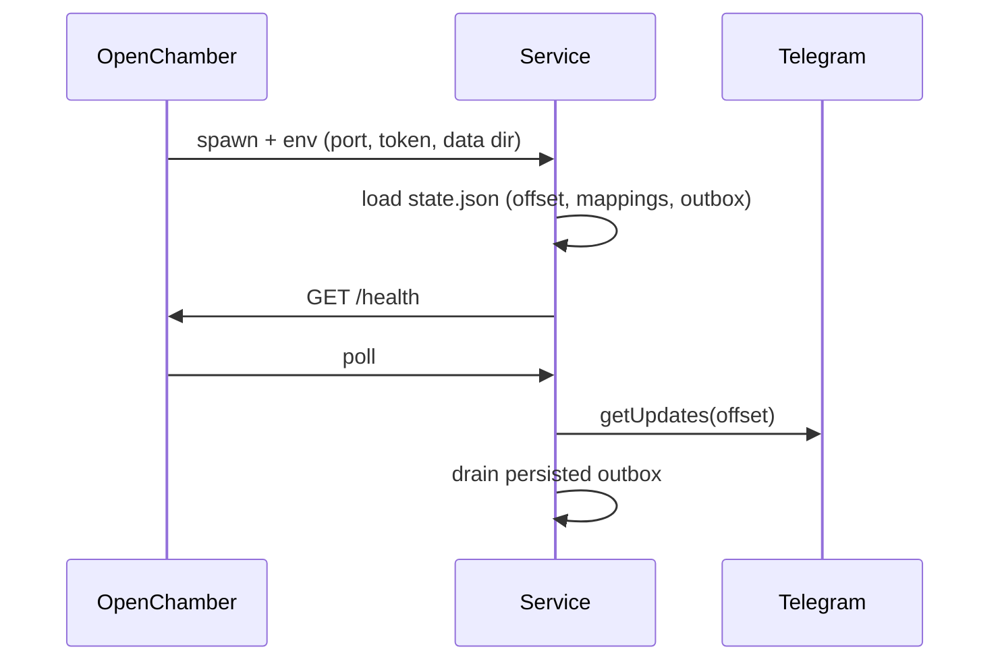

# Telegram Desk — design

Telegram Desk is an OpenChamber extension that carries the two things a chat UI cannot
carry to a phone: the agent's **questions and permission requests**, and the user's
**answers**. It also exposes a small command surface for operating sessions away from the
desk.

This document records the SDK facts the design relies on, the architecture, the data
model, and the security rules. It is intentionally shorter than the implementation.

## 1. What the SDK actually gives us

The extension is a normal guest package (`apiVersion: 1`) with a host service. Nothing
here patches OpenChamber or OpenCode.

### Available and used

| Contract | What it gives | Where used |
|---|---|---|
| `contributes.sessionEvents` | `question-asked`, `permission-asked`, `turn-finished`, `turn-failed`, `turn-started`, `session-created`; `content: true` adds the transcript fields | Every card and notification |
| `question-asked` content | `ask.kind` (`form` or `page`), form `id`, `title`, `fields[]` with `key/type/title/description/required/options/custom/when` | Form cards and answers |
| `permission-asked` content | `action`, `resources[]`, `message` | Allow/Deny cards |
| `turn-finished` / `turn-failed` content | `sessionTitle`, `reply` (64k cap), `replyTruncated`, or `error { type, message }` | Short notifications |
| `contributes.sessionControl` | `sessions.send`, `stop`, `status`, `lastReply`, `retry`, `answerForm`, `answerPermission` | Commands and callbacks |
| `contributes.sessionControl.answers` | `answerForm` / `answerPermission` with the user's authority | Button callbacks |
| `contributes.service.provides: ["opencode"]` | Loopback `/api/session` (and other listed reads) with the service bearer | `/status`, `/sessions`, `/digest` |
| `service.keepRunning: true` | Service starts with OpenChamber and is restarted when it dies | Telegram long polling |
| `integration.settings` with `secret: true` | Values stored by OpenChamber and readable only by the service via `readSettings()` | Bot token, allowlist, notification default |

### Available but not usable, or deliberately unused

| Gap | Consequence |
|---|---|
| No `listSessions` in `sessionControl` | The service uses the separately approved `opencode` role. If that grant is missing, it falls back to sessions observed in events. |
| `callback_data` is limited to **64 bytes** | The callback carries a short random ref; the ref maps to `sessionId`, `formId`, `requestId`, and option value in persisted state. Embedding full IDs is impossible. |
| `question-asked` with `ask.kind: "page"` cannot be answered by a service | The bot sends a notice; a reply to that notice goes through `sessions.send`, which closes the page and delivers the text. |
| No "Always allow" | Permission cards offer **Allow once** / **Deny** only. "Always allow" remains a click in OpenChamber. |
| Integration auth token is not exposed to services | The bot token is a `secret` integration *setting*. The manifest still requires an auth kind, so the integration card shows a vestigial API-token field; see README for the exact setup. |
| Session events are delivered **at most once**, with a 10 s timeout | The service persists an outbox and answers the event endpoint immediately; a lost event is not replayed by the host. The outbox survives service restarts. |
| No arbitrary inbound network routes | The service is only reachable on its host-minted loopback port. Telegram is reached by outbound long polling. |
| VS Code / mobile clients | VS Code does not load extensions. Mobile clients see an already-running server service but never spawn one. |

## 2. Architecture

```
Telegram users
     │  long poll + sendMessage
     ▼
Telegram Bot API  ◄──────────────┐
                                 │ HTTPS
┌────────────────────────────────┴─────────────────────────────┐
│ OpenChamber host (web / desktop / server)                    │
│                                                              │
│  panel iframe ──serviceRequest──► loopback proxy ──┐          │
│         ▲                                         │          │
│         │ host events                             ▼          │
│  ┌──────┴───────────────────────────────────────────────┐    │
│  │ Telegram Desk service (Node, 127.0.0.1)              │    │
│  │  HTTP: /health /status /pair /test /session-events   │    │
│  │  poller ── outbox ── command router ── form engine   │    │
│  │  state.json in OPENCHAMBER_SERVICE_DATA_DIR          │    │
│  └──────┬───────────────────────────────┬───────────────┘    │
│         │ host callback /service/call   │ OpenCode loopback  │
│         ▼                               ▼                    │
│  sessions.send/stop/status/...     /api/session              │
└──────────────────────────────────────────────────────────────┘
```

The panel never sees the bot token. It calls the service through the host's
`serviceRequest` proxy; the service returns only status metadata.

## 3. Data model

`OPENCHAMBER_SERVICE_DATA_DIR/state.json` is written atomically (temp file + rename, mode
0600). It contains no bot token and no full transcripts.

```jsonc
{
  "version": 1,
  "offset": 123456,                 // Telegram getUpdates offset
  "pairedIds": [123456789],         // IDs learned through the pairing code
  "primaryChatId": 123456789,       // where event cards are sent
  "pairCode": { "code": "ABCD2345", "createdAt": 0, "expiresAt": 0 },
  "pairAttempts": { "chatId": [0] },
  "messages": {                     // bot message -> session routing
    "chatId:messageId": { "sessionId": "ses_…", "sessionTitle": "…", "kind": "form", "at": 0 }
  },
  "refs": {                         // opaque callback refs
    "ab12cd34ef": {
      "kind": "question", "sessionId": "ses_…", "formId": "frm_…",
      "fieldKey": "choice", "value": "yes", "label": "Yes", "at": 0
    }
  },
  "forms": {
    "ses_…:frm_…": {
      "sessionId": "ses_…", "formId": "frm_…", "title": "…",
      "fields": [ /* sanitized GuestFormField[] */ ],
      "answers": { "choice": "yes" },
      "chatId": 0, "messageId": 0, "closed": false, "updatedAt": 0
    }
  },
  "permissions": {
    "ab12cd34ef": { "sessionId": "ses_…", "requestId": "perm_…", "chatId": 0, "messageId": 0, "closed": false }
  },
  "processedCallbacks": { "callbackQueryId": { "at": 0, "outcome": "answered" } },
  "seenEvents": { "evt_…": 0 },
  "seenUpdates": { "123456": 0 },
  "sessionRegistry": {
    "ses_…": { "title": "…", "parentId": null, "directory": "/repo", "status": "busy", "updatedAt": 0 }
  },
  "watchedSessions": { "ses_…": 0 },
  "preferences": { "notifyMode": null },
  "outbox": [
    { "id": "…", "eventId": "evt_…", "chatId": 0, "text": "…", "keyboard": [], "sessionId": "ses_…", "attempts": 0, "nextAt": 0 }
  ],
  "recentEvents": [ { "id": "…", "type": "turn-finished", "sessionId": "ses_…", "at": 0, "delivery": "sent" } ],
  "stats": { "events": 0, "sent": 0, "answers": 0, "errors": 0 }
}
```

### Why an opaque ref table

Telegram rejects `callback_data` over 64 bytes. A real session id plus form id already
exceeds that. Each button therefore gets a 10-character random ref. The ref table is the
authority: a press is accepted only if the ref exists, belongs to an allowed chat, and
the underlying request is still open. Refs are removed with their form/permission.

### Lifecycle and pruning

- `messages` and refs are kept for 14 days; open forms and permissions for 7 days, closed
  forms for 1 day.
- `processedCallbacks` (3 days), `seenEvents` (7 days), `seenUpdates` (1 day) are bounded.
- `recentEvents` keeps the last 40 metadata records for the panel and `/digest`.
- `outbox` is capped at 100 items; old items are dropped with a recorded failure.

## 4. Flows

### 4.1 Question



### 4.2 Permission



### 4.3 Reply routing



### 4.4 Restart



Offset and mappings survive. Long polling resumes where it stopped. The outbox replays
undelivered cards. There is a small at-most-once window if the process dies after Telegram
accepted a send but before the outbox item was removed; the message may repeat.

## 5. Security

- **Loopback only.** `server.listen(port, '127.0.0.1')`. No `0.0.0.0`.
- **Bearer everywhere.** Every route, including `/health`, compares
  `Authorization: Bearer <OPENCHAMBER_SERVICE_TOKEN>` in constant time.
- **Allowlist.** A message or callback is processed only when `from.id` or `chat.id` is in
  the effective allowlist (settings + paired IDs). Unauthorized messages are ignored;
  unauthorized callbacks are acknowledged and dropped.
- **Pairing.** Codes are 8 characters, 10-minute TTL, one use, private chats only, limited
  attempts per chat. A new pairing also sets the primary event chat if none exists.
- **Token isolation.** The bot token lives only in the integration secret setting and
  service memory. It is never written to state, never returned by `/status`, never logged.
  The logger redacts `123456:AA…` patterns and `Bearer` values.
- **HTML.** All agent/user text is HTML-escaped before `parse_mode: "HTML"`. No Markdown
  from the agent is interpreted. A Telegram parse error triggers one plain-text fallback.
- **Length.** Every message is capped under Telegram's 4096 limit; option labels, session
  titles, error messages and reply excerpts have their own caps.
- **Idempotency.** `callback_query.id` is recorded before its effect is acknowledged.
  Update IDs and event IDs are deduplicated. Refs are single-use where the action is
  terminal (permission answer, submit, dismiss).
- **Rate limits.** Per-chat command and callback token buckets; per-session and global
  notification cooldowns; outbox pacing. Telegram 429 `retry_after` is honoured.
- **No transcript logs.** Logs contain IDs, types and error codes, not message bodies or
  form answers. The outbox is the only place with rendered text, and it is pruned. Open
  form answers are persisted so a button or text reply still works after a restart; the
  data folder is removed with the extension.

## 6. Commands and notifications

| Command | Behaviour |
|---|---|
| `/start [code]` | Pair, or explain how to pair |
| `/status` | Waiting / busy / idle sessions with pending-answer markers |
| `/sessions` | Recent sessions with IDs and indexes |
| `/send <session> <text>` | Resolve by index, full ID, unique prefix or unique title; `sessions.send` |
| `/stop <session>` | Resolve; `sessions.stop` |
| `/digest` | Counts, pending requests, and events since the last digest |
| `/help` | Command list |
| Reply to a bot message | Answer an open form field, or send text to the mapped session |

Notification modes:

- `all` (default) — every top-level turn finish/failure, still under the cooldowns below.
- `active` — only sessions that asked a question, requested a permission, were messaged
  from Telegram, or had a Telegram reply in the last 24 h.
- `off` — no turn notifications.

A session finish is additionally suppressed for 20 s per session and 10 per minute
globally. The event is still recorded in `/digest`.

## 7. Test plan

- Unit: callback data, allowlist/pairing, store persistence, formatting and escaping,
  Telegram client (mocked fetch), host client, OpenCode client, form engine, command
  router, event policy.
- Smoke: real loopback HTTP service + fake Telegram API + fake host callback; post a
  `question-asked` event, extract the inline button, feed it back as a Telegram update,
  assert `sessions.answerForm`; restart with the same data dir and assert the mapping and
  offset survive; assert no token appears in logs; assert an unauthorized chat is ignored.
- Manifest: `parseManifestJson` from `@openchamber/sdk` plus the packaged files the host
  checks at install.

A real-token smoke checklist is in `docs/smoke-test.md`.
