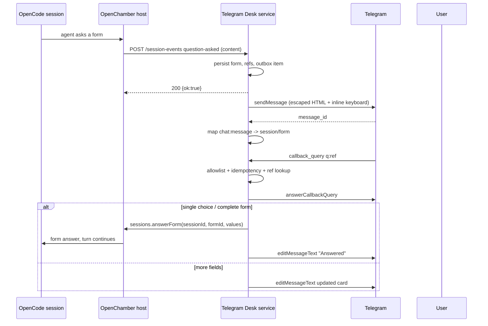
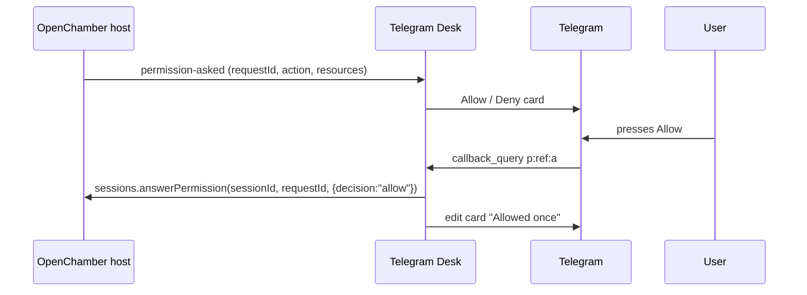
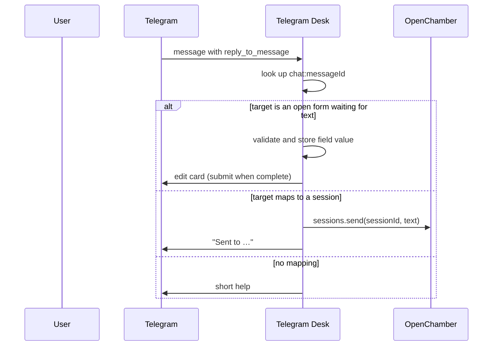
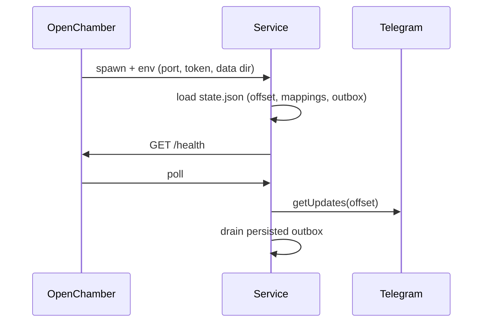

# Telegram Desk — design

Telegram Desk is an OpenChamber extension that carries the two things a chat UI cannot
carry to a phone: the agent's **questions and permission requests**, and the user's
**answers**. It also exposes a small command surface for operating sessions away from the
desk.

This document records the SDK facts the design relies on, the architecture, the data
model, and the security rules. It is intentionally shorter than the implementation.

## 1. What the SDK actually gives us

The extension is a normal guest package (`apiVersion: 1`) with a host service. Nothing
here patches OpenChamber or OpenCode.

### Available and used

| Contract | What it gives | Where used |
|---|---|---|
| `contributes.sessionEvents` | `question-asked`, `permission-asked`, `turn-finished`, `turn-failed`, `turn-started`, `session-created`, `session-archived`, `session-deleted`; `content: true` adds the transcript fields | Every card and notification; lead removal and deletion cleanup |
| `question-asked` content | `ask.kind` (`form` or `page`), form `id`, `title`, `fields[]` with `key/type/title/description/required/options/custom/when` | Form cards and answers |
| `permission-asked` content | `action`, `resources[]`, `message` | Allow/Deny cards |
| `turn-finished` / `turn-failed` content | `sessionTitle`, `reply` (64k cap), `replyTruncated`, or `error { type, message }` | Full turn notices (rich message or parts), error cards |
| `contributes.sessionControl` | `sessions.start`, `sessions.send`, `stop`, `status`, `lastReply`, `retry`, `answerForm`, `answerPermission` | Commands and callbacks |
| `contributes.sessionControl.answers` | `answerForm` / `answerPermission` with the user's authority | Button callbacks |
| `contributes.service.provides: ["opencode"]` | Loopback `/api/session` (and other listed reads) with the service bearer | `/status`, `/sessions`, `/digest` |
| `sessions.start` | Creates a session with `prompt`, optional `directory`/`projectId`/`title`/`model`/`agent`; returns `{ sessionId, directory }`; the session is marked `startedByExtension` | `/new` |
| `service.keepRunning: true` | Service starts with OpenChamber and is restarted when it dies | Telegram long polling |
| `integration.settings` with `secret: true` | Values stored by OpenChamber and readable only by the service via `readSettings()` | Bot token, allowlist, notification default |

### Available but not usable, or deliberately unused

| Gap | Consequence |
|---|---|
| No `listSessions` in `sessionControl` | The service uses the separately approved `opencode` role. If that grant is missing, it falls back to sessions observed in events. |
| A service gets no context directory for `sessions.start` | `session.create` validates the directory, so `/new` passes the directory of the most recent top-level session; without one it asks to open a project first. |
| `callback_data` is limited to **64 bytes** | The callback carries a short random ref; the ref maps to `sessionId`, `formId`, `requestId`, and option value in persisted state. Embedding full IDs is impossible. |
| `question-asked` with `ask.kind: "page"` cannot be answered by a service | The bot sends a notice; a reply to that notice goes through `sessions.send`, which closes the page and delivers the text. |
| No "Always allow" | Permission cards offer **Allow once** / **Deny** only. "Always allow" remains a click in OpenChamber. |
| Integration auth token is not exposed to services | The bot token is a `secret` integration *setting*. The manifest still requires an auth kind, so the integration card shows a vestigial API-token field; see README for the exact setup. |
| Session events are delivered **at most once**, with a 10 s timeout | The service persists an outbox and answers the event endpoint immediately; a lost event is not replayed by the host. The outbox survives service restarts. |
| No arbitrary inbound network routes | The service is only reachable on its host-minted loopback port. Telegram is reached by outbound long polling. |
| VS Code / mobile clients | VS Code does not load extensions. Mobile clients see an already-running server service but never spawn one. |

## 2. Architecture

```
Telegram users
     │  long poll + sendMessage
     ▼
Telegram Bot API  ◄──────────────┐
                                 │ HTTPS
┌────────────────────────────────┴─────────────────────────────┐
│ OpenChamber host (web / desktop / server)                    │
│                                                              │
│  panel iframe ──serviceRequest──► loopback proxy ──┐          │
│         ▲                                         │          │
│         │ host events                             ▼          │
│  ┌──────┴───────────────────────────────────────────────┐    │
│  │ Telegram Desk service (Node, 127.0.0.1)              │    │
│  │  HTTP: /health /status /sessions /lead /pair /test   │    │
│  │  /session-events                                     │    │
│  │  poller ── outbox ── command router ── form engine   │    │
│  │  state.json in OPENCHAMBER_SERVICE_DATA_DIR          │    │
│  └──────┬───────────────────────────────┬───────────────┘    │
│         │ host callback /service/call   │ OpenCode loopback  │
│         ▼                               ▼                    │
│  sessions.send/stop/status/...     /api/session              │
└──────────────────────────────────────────────────────────────┘
```

The panel never sees the bot token. It calls the service through the host's
`serviceRequest` proxy; the service returns only status metadata.

## 3. Data model

`OPENCHAMBER_SERVICE_DATA_DIR/state.json` is written atomically (temp file + rename, mode
0600). It contains no bot token and no full transcripts.

```jsonc
{
  "version": 1,
  "offset": 123456,                 // Telegram getUpdates offset
  "pairedIds": [123456789],         // IDs learned through the pairing code
  "primaryChatId": 123456789,       // where event cards are sent
  "leadSessionId": "ses_…",         // the only session allowed to reach Telegram; null = mode-wide
  "leadSessionTitle": "…",          // title at bind time / last event
  "leadSetAt": 0,                   // when the panel bound it
  "leadPaused": false,              // true after the lead was deleted or archived; clears on bind
  "pairCode": { "code": "ABCD2345", "createdAt": 0, "expiresAt": 0 },
  "pairAttempts": { "chatId": [0] },
  "messages": {                     // bot message -> session routing
    "chatId:messageId": { "sessionId": "ses_…", "sessionTitle": "…", "kind": "form", "at": 0 }
  },
  "refs": {                         // opaque callback refs
    "ab12cd34ef": {
      "kind": "question", "sessionId": "ses_…", "formId": "frm_…",
      "fieldKey": "choice", "value": "yes", "label": "Yes", "at": 0
    }
  },
  "forms": {
    "ses_…:frm_…": {
      "sessionId": "ses_…", "formId": "frm_…", "title": "…",
      "fields": [ /* sanitized GuestFormField[] */ ],
      "answers": { "choice": "yes" },
      "chatId": 0, "messageId": 0, "closed": false, "updatedAt": 0
    }
  },
  "permissions": {
    "ab12cd34ef": { "sessionId": "ses_…", "requestId": "perm_…", "chatId": 0, "messageId": 0, "closed": false }
  },
  "processedCallbacks": { "callbackQueryId": { "at": 0, "outcome": "answered" } },
  "seenEvents": { "evt_…": 0 },
  "seenUpdates": { "123456": 0 },
  "sessionRegistry": {
    "ses_…": { "title": "…", "parentId": null, "directory": "/repo", "status": "busy", "updatedAt": 0 }
  },
  "watchedSessions": { "ses_…": 0 },
  "lastSessionLists": { "chatId": ["ses_…", null] }, // /sessions indexes; null keeps a deleted slot
  "preferences": { "notifyMode": null },
  "outbox": [
    { "id": "…", "eventId": "evt_…", "chatId": 0, "text": "…", "keyboard": [], "sessionId": "ses_…", "attempts": 0, "nextAt": 0 }
  ],
  "recentEvents": [ { "id": "…", "type": "turn-finished", "sessionId": "ses_…", "at": 0, "delivery": "sent" } ],
  "stats": { "events": 0, "sent": 0, "answers": 0, "errors": 0, "ignored": 0 }
}
```

### Why an opaque ref table

Telegram rejects `callback_data` over 64 bytes. A real session id plus form id already
exceeds that. Each button therefore gets a 10-character random ref. The ref table is the
authority: a press is accepted only if the ref exists, belongs to an allowed chat, and
the underlying request is still open. Refs are removed with their form/permission.

### Lifecycle and pruning

- `messages` and refs are kept for 14 days; open forms and permissions for 7 days, closed
  forms for 1 day.
- `processedCallbacks` (3 days), `seenEvents` (7 days), `seenUpdates` (1 day) are bounded.
- `recentEvents` keeps the last 40 metadata records for the panel and `/digest`.
- `outbox` is capped at 100 items; old items are dropped with a recorded failure.
- `session-deleted` removes the session from `sessionRegistry` and `watchedSessions` and
  drops its queued outbox items, so `/sessions` stops listing it at once. This cleanup runs
  for every deleted session, including non-lead sessions while a lead is bound and any
  deletion while the binding is paused. Open forms and
  permissions for that session are closed with a note, but their state, refs and message
  routes stay: an old button press is a stale no-op, and an old reply still resolves to
  that session (the host answers “Session not found”) instead of being sent elsewhere.
  Last `/sessions` indexes keep their positions with a `null` hole, so an old
  `/send <number>` cannot silently address a different session.
- A `session-archived` for the lead is handled like a deletion for delivery purposes: the
  registry/watch entry and queued cards are dropped, its open cards close with an archived
  note, the binding is cleared with `leadPaused: true`, and the primary chat is asked to
  choose a new lead. A `session-deleted` for the lead does the same after the normal
  cleanup. Neither event ever selects another session automatically.

## 4. Flows

### 4.0 Lead gating

```
POST /lead {sessionId} ──► validate (OpenCode list, then host sessions.status)
                              │
                              ▼
                   state.leadSessionId + title + setAt
                   close other sessions' open cards
                   drop queued outbox items for other sessions
```

Every session event is checked before any handler runs:

- no lead, not paused → today's all/active/off policy;
- lead set and event.session.id === lead → normal handling;
- lead set and another session → record the event as `ignored`, increment
  `stats.ignored`, return; no registry, form, permission, ref or outbox entry. The one
  exception is `session-deleted`: its registry/watch/outbox/card cleanup always runs, while
  delivery stays ignored and the lead binding is untouched;
- no lead and `leadPaused` → every session event is ignored until a new lead is bound;
  `session-deleted` still runs its cleanup.

The callback flow uses the same rule: a callback ref whose `sessionId` is not the lead is
closed as stale and acknowledged without calling the host. A reply to any bot
message is sent to the lead, except a reply to another session's question card, which is
closed as stale. `/status`, `/sessions`, `/send`, `/stop` and `/digest` use the lead;
`/new` is refused with the lead title and a `/send` hint.

### 4.1 Question



### 4.2 Permission



### 4.3 Reply routing



### 4.4 Restart



Offset and mappings survive. Long polling resumes where it stopped. The outbox replays
undelivered cards. There is a small at-most-once window if the process dies after Telegram
accepted a send but before the outbox item was removed; the message may repeat.

## 5. Security

- **Loopback only.** `server.listen(port, '127.0.0.1')`. No `0.0.0.0`.
- **Bearer everywhere.** Every route, including `/health`, compares
  `Authorization: Bearer <OPENCHAMBER_SERVICE_TOKEN>` in constant time.
- **Allowlist.** A message or callback is processed only when `from.id` or `chat.id` is in
  the effective allowlist (settings + paired IDs). Unauthorized messages are ignored;
  unauthorized callbacks are acknowledged and dropped.
- **Pairing.** Codes are 8 characters, 10-minute TTL, one use, private chats only, limited
  attempts per chat. A new pairing also sets the primary event chat if none exists.
- **Token isolation.** The bot token lives only in the integration secret setting and
  service memory. It is never written to state, never returned by `/status`, never logged.
  The logger redacts `123456:AA…` patterns and `Bearer` values.
- **HTML and rich text.** Text in ordinary messages is HTML-escaped before
  `parse_mode: "HTML"`; a Telegram parse error triggers one plain-text fallback. A finished
  turn's reply goes as a Telegram rich message (`sendRichMessage`, Markdown) when it fits;
  a refusal falls back to escaped HTML parts.
- **Length.** Ordinary messages are capped under Telegram's 4096 limit; a reply that does not
  fit a rich message (32,768 characters) is split into parts at line boundaries. Option
  labels, session titles and error messages have their own caps.
- **Idempotency.** `callback_query.id` is recorded before its effect is acknowledged.
  Update IDs and event IDs are deduplicated. Refs are single-use where the action is
  terminal (permission answer, submit, dismiss).
- **Rate limits.** Per-chat command and callback token buckets; per-session and global
  notification cooldowns; outbox pacing. Telegram 429 `retry_after` is honoured. OpenChamber
  also limits a service to 60 prompts an hour; `/new` and `/send` share that budget.
- **No transcript logs.** Logs contain IDs, types and error codes, not message bodies or
  form answers. The outbox is the only place with rendered text, and it is pruned. Open
  form answers are persisted so a button or text reply still works after a restart; the
  data folder is removed with the extension.

## 6. Commands and notifications

| Command | Behaviour |
|---|---|
| `/start [code]` | Pair, or explain how to pair |
| `/status` | Waiting / busy / idle sessions with pending-answer markers; only the lead when bound |
| `/sessions` | Recent sessions with IDs and indexes; only the lead when bound |
| `/new <task>` | Start a session with `sessions.start` and send the task; refused when a lead is bound |
| `/send <session> <text>` | Resolve by index, full ID, unique prefix or unique title; `sessions.send`; `/send <text>` targets the lead |
| `/stop [session]` | Resolve; `sessions.stop`; no argument stops the lead |
| `/digest` | Counts, pending requests, and events since the last digest |
| `/help` | Command list |
| Reply to a bot message | Answer an open form field, or send text to the mapped session; with a lead, text goes to the lead |

`/new <task>` calls `sessions.start` with the task and the directory of the most recent
top-level session: a service gets no context directory from the host, and `session.create`
validates the directory. If no session or project is known, the command says so. The new
session is recorded in the local registry as busy and watched, so `active` notifications
include it. The confirmation message is entered into the message route table, so replying to
it continues the session.

Notification modes (checked only after the lead gate):

- `all` (default) — every top-level turn finish/failure, still under the cooldowns below.
- `active` — only sessions that asked a question, requested a permission, were messaged
  from Telegram, or had a Telegram reply in the last 24 h.
- `off` — no turn notifications.

When `leadSessionId` is set, the gate applies first, so none of these modes can leak another
session. A paused binding (`leadPaused` with no id) ignores all session events until the
panel binds a new lead.

A session finish is additionally suppressed for 20 s per session and 10 per minute
globally. The event is still recorded in `/digest`.

A finished turn is one Telegram rich message with the agent's Markdown when the reply fits
the 32k rich-message cap; otherwise, or when Telegram refuses the rich message, the same
reply goes as HTML parts under 3,900 characters each. Every part is mapped back to the
session, so a reply to any part continues it; the last part carries the reply hint.

## 7. Test plan

- Unit: callback data, allowlist/pairing, store persistence (including the lead binding and
  pause), formatting and escaping, rich replies and part splitting, Telegram client (mocked
  fetch), host client, OpenCode client, form engine, command router (including `/new` start
  and fallback, and lead-scoped commands/replies), event policy (lead gate, delete/archive).
- Smoke: real loopback HTTP service + fake Telegram API + fake host callback; bind a lead
  through `POST /lead` and assert non-lead events/callbacks are ignored, commands and
  replies target the lead, `/new` is refused, the binding survives a restart, deleting the
  lead pauses delivery with a notice, and lead state survives another restart; post a
  `question-asked` event, extract the inline button, feed it back as a Telegram update,
  assert `sessions.answerForm`; run `/new` without a lead and assert `sessions.start` and
  the confirmation route; assert the token appears in neither state, status, sessions,
  Telegram payloads nor logs; assert an unauthorized chat is ignored.
- Manifest: `parseManifestJson` from `@openchamber/sdk` plus the packaged files the host
  checks at install.

A real-token smoke checklist is in `docs/smoke-test.md`.
